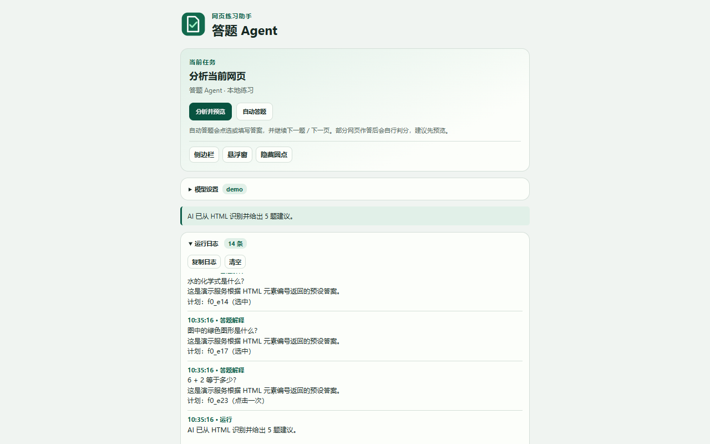

# 答题 Agent


**Powered by myxuebi**

[开源仓库](https://github.com/myxuebi/browser-answer-agent) · [反馈问题](https://github.com/myxuebi/browser-answer-agent/issues) · [隐私说明](PRIVACY.md) · [上架说明](STORE.md) · [GPL-3.0 许可证](LICENSE)

在 Chrome 116+ 或支持扩展侧栏的新版 Microsoft Edge 中，使用自定义大模型读题、预览建议并模拟点击网页上的选择题。无需构建或安装依赖；请仅在练习或经授权的网页上使用。

插件将网页 HTML 和带编号的元素交给 AI 分析，再在本地执行经过校验的点击、输入和下一题操作。支持 Chat Completions、OpenAI Responses、本机兼容接口、思考深度、图片输入和实时日志。使用者需自行配置模型服务；模型服务可能计费。



## 安装

1. 在浏览器地址栏输入 `chrome://extensions` 或 `edge://extensions`，打开「开发者模式」。
2. 点击「加载已解压的扩展程序」，选中项目下的 `extension` 文件夹（包含 `manifest.json`）。
3. 打开有练习题的网页，点击浏览器工具栏里的「答题 Agent」图标（可先在扩展菜单中固定图标）。已有侧栏时，切换到其他 HTTP 或 HTTPS 网页后可直接分析，无需逐站授权。
4. 若浏览器限制了站点访问，请在扩展详情或扩展右键菜单中选择「在所有网站上」。浏览器内部页面、扩展商店及本地文件不在支持范围内。

## 配置与使用

- 展开「模型设置」，选择 **Chat Completions** 或 **OpenAI Responses**，再填写 **API 地址**和**模型名称**。可以填写基础地址（如 `https://api.openai.com/v1`），也可以填写对应的完整 `/chat/completions` 或 `/responses` 地址。使用 Ollama 等本机兼容服务时选择 Chat Completions，可填 `http://localhost:11434/v1`；模型名填写服务提供的实际 ID。
- **思考深度**可选服务默认、低、中、高。服务默认不额外传推理参数；若模型或服务不支持显式思考深度，请使用默认。
- 模型确实支持视觉输入时，勾选 **当前模型支持读图**。插件会附带能读取的页面图片，每次最多 6 张；不开启时模型只收到 HTML 和元素信息。
- 如果接口需要鉴权，填写 **API Key**，然后点击「保存模型设置」。设置和 API Key 保存在本机的扩展存储中，重启浏览器后自动恢复，不使用浏览器同步。清空 Key 后保存即可删除。旧版会话中仍保存的 Key 会自动迁移；更换接口域名时会清空输入框里的旧 Key。
- **分析并预览**：直接把页面 HTML、文字和带编号的元素发送给 AI，由模型识别题目、选择答案并生成点击计划。预览显示模型识别的题干、目标选项和解释；检查后可取消勾选部分题目，再点「应用勾选的建议」。
- **自动答题**：AI 回答当前页题目，点选或填入答案后，再让 AI 判断是否还有下一题／下一页；有则翻页、等待内容稳定并继续分析，直到最后一题。支持页内切题和整页跳转，单次最多处理 100 页。「停止」可中断后续操作。
- 完成当前题后一定进入 AI 翻题判断；倒计时、时钟、选中状态等变化不会直接触发重新答题。点击下一题后，AI 需提供新题原文，并核对原文确实出现在当前页且不在原题页中，才会继续。连续三次未确认新题就停止，不重复作答或重点击下一题。
- **输入题**：支持普通文本框、文本域及 contenteditable 输入区，通过原生值设置和 input/change 事件通知网页，并核对输入结果。分析预览中会显示准备填写的内容。
- **悬浮窗／隐藏圆点**：通过侧栏里的入口按钮，或右键点击浏览器工具栏的插件图标启用。浮窗点「开始答题」，圆点单击开始、再次点击停止、右键展开。两个网页入口都直接点选，建议先在侧栏用「分析并预览」确认识别结果。入口只显示在当前网页，刷新后可重新启用。
- **运行日志**：侧栏和浮窗显示读页统计、模型请求、每 5 秒更新的等待时间、模型给出的答题解释、逐元素点击及结果、完成或报错。圆点右键展开即可查看日志；侧栏可复制或清空。侧栏按标签页保留当前浏览器会话内最近 300 条日志，不记录 API Key、完整 HTML 或请求头。浮窗显示启用后收到的日志。
- **推理摘要**：使用支持摘要的 Responses 模型时，可勾选「请求推理摘要」，发送 `reasoning.summary: auto`。摘要在接口返回后显示；未返回摘要时显示答题解释。等待状态只是请求进度，不是模型内部思考文本。接口不支持摘要参数时请取消勾选。

## 范围与隐私

- 不再用题目选择器预先找题。发送当前网页和可访问内嵌页面的 HTML（含开放的 Shadow DOM），由模型分析原生控件或普通 div/span 等自定义选项。执行时将模型返回的元素编号映射回原始元素，调用点击并核对可读取的选中状态；自定义元素没有选中标记时显示「已点击，未核对」。
- 为控制请求大小，移除脚本、样式、隐藏内容和事件代码，保留页面结构、文字及有用属性。为判断输入题状态，会发送可操作文本框的当前内容；密码和文件输入框不作为可操作输入控件。单个文档最多约 16 万字符、合计约 32 万字符；超出时提示已截取。每个文档最多编号 1,800 个元素，每次最多接受 50 道题的点击计划。
- 读图仅处理浏览器允许读取的已加载网页图片，不会截取整页；受跨域限制的图片、画布、浏览器内部页面及拦截合成点击的网站不保证支持。
- 插件不会点击提交按钮，但一些网页会在点选后立即判分、跳题或提交当前题。选项已变更、控件被替换或页面已切换时，插件会跳过或停止，并提示需重新分析。
- 点击分析会将清理后的页面 HTML 和元素信息发送至配置的模型，包括题目以外的可见文字；开启读图时还会发送图片。模型回答不等于正确答案。
- 插件拥有普通网页的站点访问权限，但仅在你主动使用答题功能时读取当前网页；不会自动扫描浏览记录或后台标签页。

## 本地试用

在项目目录运行 `node demo/server.mjs`，访问 `http://127.0.0.1:8787`，模型地址填 `http://127.0.0.1:8787/v1`、模型名填 `demo`，API Key 留空。两种接口均可试用；勾选读图后可处理第 4 题，第 5 题是没有题目标签或表单控件的普通 div 选项。演示模型固定返回预设结果，不连接任何外部服务。

连续答题试用：`http://127.0.0.1:8787/sequence` 为页内切题，`http://127.0.0.1:8787/sequence?full=1` 为整页跳转。共 3 题，覆盖选项点击、三类输入区和自动结束。

## 项目结构

```text
extension/       浏览器扩展，可直接加载，无需构建
demo/            本地练习页与模拟模型接口
docs/            界面截图
PRIVACY.md       数据处理与隐私说明
STORE.md         Chrome / Edge 商店提交资料和操作步骤
LICENSE          仓库原有的 GPL-3.0 许可证
```

## 更新与打包

开发模式安装后，更新文件需要在扩展管理页点击「重新加载」，并刷新正在使用的答题网页。模型设置保存在浏览器扩展存储中，不在代码仓库内。

商店包需将 `extension` 目录下的文件直接压缩到 ZIP 根目录，确保解压后第一层可见 `manifest.json`，不要把整个项目目录作为商店包。发布材料见 [STORE.md](STORE.md)。

## 贡献与许可证

欢迎通过 [Issues](https://github.com/myxuebi/browser-answer-agent/issues) 反馈问题；请附浏览器版本、扩展版本和已脱敏的日志，不要上传 API Key 或私人网页内容。

沿用仓库现有 [GNU GPL v3](LICENSE) 许可证。
